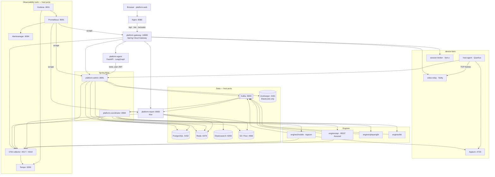

# Valdifly

Author, run, and analyze automated tests.

Nginx on port 8080 is the only browser entry. It forwards `/api`, `/ws`, and `/actuator` to the gateway. The gateway routes by Compose service name. A run goes from admin through Kafka to the coordinator, then to one engine. The report service reads the result.



## Repository

`platform-agent`, `device-farm`, `deployment/kubernetes`, `deployment/terraform`, and `deployment/ansible` are added when those files exist.

```text
valdifly/
├── platform-web/
├── platform-gateway/
├── platform-admin/
├── platform-coordinator/
├── platform-report/
├── platform-agent/
├── engines/
│   ├── core/
│   ├── mobile/
│   ├── api/
│   ├── playwright/
│   └── k6/
├── device-farm/
│   ├── host-agent/
│   ├── session-broker/
│   └── video-relay/
├── contracts/
│   ├── engine/
│   └── platform-api/
├── shared/
│   ├── java/
│   │   ├── domain/
│   │   ├── infrastructure/
│   │   ├── spring/
│   │   └── utils/
│   └── typescript/
│       └── engine/
├── deployment/
│   ├── docker-compose/
│   ├── kubernetes/
│   ├── terraform/
│   └── ansible/
└── docs/
    ├── architecture/
    ├── standards/
    └── uml/
```

One Gradle build covers the JVM modules. One npm workspace covers `platform-web`, `engines/playwright`, `engines/k6`, and `shared/typescript/engine`. JDK 21.

## Read next

| Topic | Where |
|---|---|
| Scope, services, and stack | [docs/architecture/README.md](docs/architecture/README.md) |
| Domain model | [shared/java/domain/README.md](shared/java/domain/README.md) |
| Coding standards | [docs/standards/CODING_STANDARDS.md](docs/standards/CODING_STANDARDS.md) |
| Aggregate rules | [docs/standards/DDD_STANDARDS.md](docs/standards/DDD_STANDARDS.md) |
| Engines | [engines/README.md](engines/README.md) |
| HTTP contract | [contracts/platform-api/README.md](contracts/platform-api/README.md) |
| Run locally | [deployment/docker-compose/README.md](deployment/docker-compose/README.md) |

## Run

```shell
cd deployment/docker-compose
docker compose up -d
```

`./gradlew test` and `npm test` run from the repo root. Use JDK 21.
